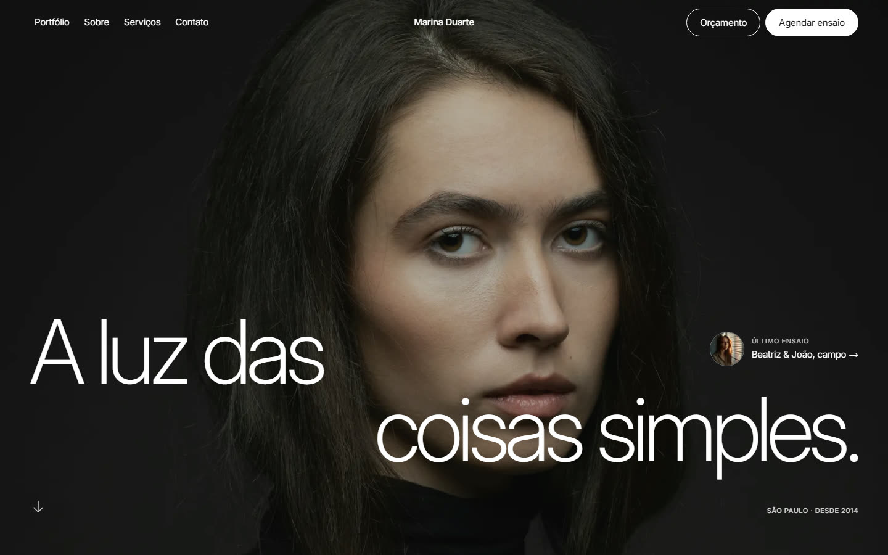

# Marina Duarte — Fotografia

Site de portfólio de uma fotógrafa fictícia em São Paulo: página única em português, com portfólio filtrável, carrossel de retratos, serviços, depoimento e pedido de orçamento via `mailto:`.



## Stack

- [Next.js 16](https://nextjs.org) (App Router, TypeScript strict) + React 19
- [Tailwind CSS v4](https://tailwindcss.com) com tokens em `@theme`
- Inter self-hosted via `next/font` — sem requisições ao Google em runtime
- Imagens locais otimizadas por `next/image`

## Rodando localmente

```bash
npm install
npm run dev
```

Abra [http://localhost:3000](http://localhost:3000).

Outros scripts:

```bash
npm run build   # build de produção
npm start       # serve o build
npm run lint    # ESLint
```

## Estrutura

```
app/                 # layout, página e estilos globais (Tailwind @theme)
components/          # seções independentes (Hero, Portfolio, Contact, …)
lib/content.ts       # todo o conteúdo editável (textos, preços, fotos, contatos)
lib/ui.ts            # classes base de botões + helper cn
public/img/          # fotos do site (hero, p1–p12, c1–c6, about)
docs/                # especificação de design e prévia para o README
legacy/              # versão estática anterior (HTML/CSS/JS), preservada
PRODUCT.md           # contexto de produto (público, ação primária, restrições)
DESIGN.md            # sistema visual documentado (tokens, componentes, movimento)
```

## Personalização

- **Nome, contatos, preços, textos e fotos**: `lib/content.ts` e `app/layout.tsx` (título/description/OG).
- **Cores, tipografia e espaçamentos**: tokens em `app/globals.css`.
- **Formulário**: monta um link `mailto:` em `components/Contact.tsx`. Para receber mensagens de verdade, troque por Formspree/Netlify Forms ou por um route handler.
- **Fotos**: mantenha os nomes em `public/img/` (cróps recomendados: 4:5 → 1000×1250, 1:1 → 1100×1100, hero 16:9 → 2560×1440).
- **Domínio fictício**: ajuste `metadataBase` em `app/layout.tsx` ao publicar.

## Deploy

O build é estático por página e roda em qualquer host Next.js — na [Vercel](https://vercel.com/new), basta importar o repositório e manter os comandos padrão (`npm run build`).

## Créditos e licenças

- Fotos: [Unsplash](https://unsplash.com) (licença Unsplash). A procedência de cada arquivo está em `DESIGN.md`.
- Fonte: [Inter](https://rsms.me/inter/), licença SIL Open Font License.
- Nome, depoimentos, contatos e preços são ficção de portfólio — edite antes de publicar.
